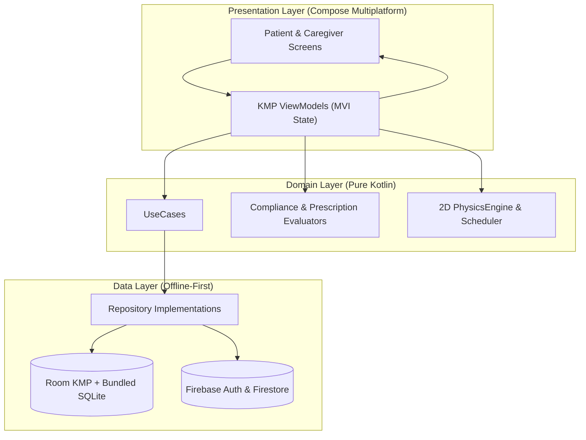

<div style="text-align: center;">

# PillFlow

### Tactile, Offline-First Medication Adherence & Caregiver Ecosystem
**Built with Kotlin Multiplatform (KMP) & Compose Multiplatform for Android & iOS**

[](https://kotlinlang.org/)
[](https://www.jetbrains.com/lp/compose-multiplatform/)
[](https://kotlinlang.org/docs/multiplatform.html)
[](https://developer.android.com/kotlin/multiplatform/room)
[](https://firebase.google.com/)

</div>

---

## Overview

**PillFlow** is a cross-platform mobile health application engineered with **Kotlin Multiplatform (KMP)** and **100% shared Compose Multiplatform UI**. It replaces sterile, easy-to-ignore medication checklists with a **tactile, sensor-driven 2D/3D-shaded physics Pill Dish** for patients, paired in real time with a **live remote monitoring and escalation command center** for caregivers.

Designed around an **offline-first Room SQLite architecture** with real-time **Cloud Firestore synchronization**, PillFlow guarantees that medication schedules, inventory counts, compliance analytics, and life-critical reminders remain accurate and responsive regardless of network connectivity.

---

## Key Features

### 1. Interactive Sensor-Driven Pill Dish & 2D Physics Engine
- **Hardware Accelerometer & Gyroscope Fusion:** Streams real-time device tilt vectors (`SensorManager` on Android at `SENSOR_DELAY_GAME`; `CMMotionManager` on iOS at `60 Hz`) into a custom 60 FPS rigid-body physics simulation (`PhysicsEngine`).
- **Tilt-to-Dispense Mechanics:** Pending doses within their active window populate the virtual pill dish with customizable shapes (`CIRCLE`, `OVAL`, `CAPSULE`) and specular 3D canvas shading. Patients physically tilt their phone to roll pills through the dispense chute.
- **Tactile Haptic Feedback:** Delivers subtle micro-vibrations on inter-pill and boundary collisions (`tickCollision`) and a heavy confirmation pulse (`pulseDispensed`) the moment a dose is dispensed.
- **Calibratable Sensitivity:** Configurable physics sensitivity (`LOW`, `NORMAL`, `HIGH`) in Settings to accommodate elderly users or limited mobility.

### 2. Dual-Role Experience: Patient & Caregiver Modes
- **Patient Mode:** Focused on frictionless daily adherence, featuring the interactive Pill Dish, Medicine Cabinet supply tracker, 1-tap PRN (*As-Needed*) logging, clinical dose skipping, and monthly adherence heatmaps.
- **Caregiver Mode:** A multi-patient monitoring hub with an animated `PillFlowPatientCarousel`, live daily status cards, 1-tap phone dialer integration, instant remote **Nudge** alerts, and full remote prescription & refill management on behalf of linked patients.
- **6-Digit Pairing Handshake:** Patients generate a 6-digit pairing code; caregivers enter the code, preview the patient's profile, assign a relationship label (e.g., *Mom*, *Father*), and establish a live bidirectional link.

### 3. Clinical Compliance State Machine
Evaluates every scheduled dose across strict clinical time windows (`DoseStateMachine` & `DoseComplianceEvaluator`):
- **On-Time (`ON_TIME`):** Logged within $\pm 30\text{ minutes}$ of the scheduled time ($100\%$ adherence weight).
- **Late (`LATE`):** Logged between $+30\text{ minutes}$ and $+2\text{ hours}$ ($80\%$ adherence weight).
- **Missed (`MISSED`):** Unlogged beyond $+2\text{ hours}$ ($0\%$ adherence weight).
- **Skipped (`SKIPPED`):** Explicitly omitted with a clinical reason (*Doctor Advised*, *Fasting / Lab Work*, *Side Effects / Nausea*, *Out of Supply*). Excluded from penalizing the patient's adherence score and preserves bottle inventory.
- **As-Needed (`PRN`):** Logged on-demand without a fixed clock schedule; decrements pill inventory and records to the audit log without skewing scheduled compliance metrics.

### 4. Automated Medication Inventory & Refill System
- **Medicine Cabinet Monitoring:** Tracks `remainingPills` and `refillThreshold` per prescription, automatically computing **Estimated Days of Supply** ($\lfloor\text{Remaining Pills} / \text{Daily Doses}\rfloor$) and surfacing low-supply or out-of-stock alerts on both Patient and Caregiver dashboards.
- **Exact-Once Atomic Decrements:** Every dose ingestion path (3D Jar tilt, PRN sheet, or lock-screen notification action) executes an idempotent SQLite decrement (`MAX(0, remainingPills - 1)`) guarded against duplicate offline sync replays.
- **1-Tap `RefillSheet`:** Interactive bottom sheet with live supply projections and quick-add presets (`+10`, `+30`, `+60`, `+90`, or custom count).

### 5. Multi-Stage Smart Alarms, Lock-Screen Actions & Reboot Resilience
- **3-Stage Patient Reminder Pipeline:**
    1. **Advance (`-30m`):** Gentle heads-up notification that a dose is approaching.
    2. **Due Now (`0m`):** High-priority alarm with `PowerManager` wake lock and full-screen lock-screen presentation.
    3. **Grace Window Closing (`+15m`):** Urgent reminder 15 minutes before the on-time window expires.
- **Direct Lock-Screen Actions:** Patients can tap **"Take Now"** or **"Snooze 15m"** directly from the notification banner without opening the app (`DoseActionReceiver`).
- **2-Stage Caregiver Escalations:** Automatically schedules `+30m` (*Dose Late*) and `+2h` (*Dose Missed*) escalation alarms on the Caregiver's device, cancelling them automatically in real time as soon as the patient logs or skips the dose.
- **Reboot & Timezone Recovery:** `BootReceiver` intercepts `BOOT_COMPLETED`, `MY_PACKAGE_REPLACED`, `TIME_SET`, and `TIMEZONE_CHANGED` to reconstruct all active patient reminders and caregiver escalations directly from Room SQLite.

### 6. Visual Adherence Analytics
- **Monthly Score Breakdown:** Weighted monthly adherence score with itemized counts for *On-Time*, *Late*, *Missed*, and *Skipped* doses.
- **Interactive Calendar Heatmap:** Color-coded monthly grid visualizing day-by-day compliance trends across any historical month.
- **Chronological Audit Log:** Complete timestamped record of every scheduled, taken, skipped, and PRN dose.

---

## System Architecture

PillFlow strictly enforces **Clean Architecture** with **Unidirectional Data Flow (MVI)** across three decoupled layers inside the shared KMP module:



### Offline-First Synchronization Pipeline
1. **Local Read Priority:** All UI states observe local **Room KMP** `Flow`s as the single source of truth, ensuring zero-latency screen loads without empty-state flashes.
2. **Dirty-Flag Mutation Queue (`isSynced`):** Offline actions (logging a dose, skipping, refilling, or editing a prescription) commit immediately to SQLite with `isSynced = false`.
3. **Conflict-Safe Reconciliation:** When network connectivity resumes—or during the periodic 12-hour `RollingScheduleAndSyncWorker` pass—unsynced local mutations push upward to Firestore before remote snapshots reconcile into Room, preventing stale cloud data from overwriting offline patient actions.

---

## Tech Stack

| Layer                    | Technology                          |     Version      | Purpose                                                               |
|:-------------------------|:------------------------------------|:----------------:|:----------------------------------------------------------------------|
| **Language**             | Kotlin Multiplatform (KMP)          |     `2.3.10`     | Shared business, data, and UI logic across Android & iOS              |
| **UI Framework**         | Compose Multiplatform               |     `1.11.1`     | 100% shared declarative UI, animations, and custom `Canvas`           |
| **Design System**        | Material 3                          | `1.11.0-alpha07` | Custom warm `PillFlowTheme`, dynamic Light/Dark modes, adaptive icons |
| **Local Database**       | Room KMP + Bundled SQLite           |     `2.8.4`      | Cross-platform offline-first relational persistence                   |
| **Cloud Backend**        | Firebase KMP (GitLive)              |     `2.1.0`      | Cross-platform Firebase Authentication & Cloud Firestore              |
| **Dependency Injection** | Koin Multiplatform                  |     `4.1.0`      | Modular DI across `commonMain`, `androidMain`, and `iosMain`          |
| **Navigation**           | JetBrains Navigation Compose        |     `2.9.2`      | Type-safe multiplatform navigation graph                              |
| **Concurrency**          | Kotlinx Coroutines & Flow           |     `1.9.0`      | Structured concurrency, `StateFlow`, and `channelFlow` sync           |
| **Background Work**      | AndroidX WorkManager + AlarmManager |     `2.10.0`     | 12h rolling schedule maintenance & exact RTC wakeup alarms            |
| **Serialization**        | Kotlinx Serialization               |     `1.7.3`      | DTO serialization & schema mapping                                    |

---

## Project Structure

```text
PillFlow/
├── androidApp/                                  # Android Application Module
│   └── src/main/
│       ├── kotlin/com/riramzy/pillfllow/
│       │   ├── MainActivity.kt                  # Edge-to-edge host, runtime permissions, lock-screen flags
│       │   ├── PillFlowApp.kt                   # Koin initialization & 12h WorkManager scheduling
│       │   ├── receiver/                        # BootReceiver, DoseReminderReceiver, DoseActionReceiver, CaregiverEscalationReceiver
│       │   └── worker/                          # RollingScheduleAndSyncWorker
│       └── res/                                 # Dynamic Light/Dark/Themed adaptive icons & notification vectors
│
├── iosApp/                                      # iOS Application Host (SwiftUI + Xcode Asset Catalog)
│   └── iosApp/
│       ├── iOSApp.swift                         # Firebase initialization & background task registration
│       └── Assets.xcassets/                     # iOS 18 Dynamic Light, Dark & Tinted App Icons
│
└── shared/                                      # Kotlin Multiplatform Shared Module
    └── src/
        ├── commonMain/kotlin/com/riramzy/pillfllow/
        │   ├── ui/                              # Screens, ModalBottomSheets, Custom Components, Theme, States & ViewModels
        │   ├── domain/                          # UseCases, Evaluators, DoseStateMachine, PhysicsEngine, Scheduler & Repo Interfaces
        │   ├── data/                            # Room Database, DAOs, Entities, Firestore DTOs & Repository Implementations
        │   ├── di/                              # Koin Modules (App, Database, Firebase, Repo, UseCase, ViewModel)
        │   └── utils/                           # Cross-platform TimeUtils, Physics math & status enums
        ├── androidMain/                         # Android actuals (SensorManager, AlarmManager, Vibrator, Room Builder)
        └── iosMain/                             # iOS actuals (CMMotionManager, UNUserNotificationCenter, Haptics, Room Builder)
```

---

## Getting Started

### Prerequisites
- **Android Studio** Ladybug / Meerkat or newer (JDK 17+)
- **Xcode 16+** (for iOS target & simulator)
- A **Firebase Project** with **Authentication** (Email/Password) and **Cloud Firestore** enabled

### 1. Clone the Repository
```bash
git clone https://github.com/riramzy/pillflow.git
cd pillflow
```

### 2. Configure Firebase
1. **Android:** Download `google-services.json` from your Firebase Console (package name `com.riramzy.pillflow`) and place it at:
   ```text
   androidApp/google-services.json
   ```
2. **iOS:** Download `GoogleService-Info.plist` (bundle ID `com.riramzy.pillflow.PillFlow`) and place it at:
   ```text
   iosApp/iosApp/GoogleService-Info.plist
   ```

### 3. Build & Run

#### Android
Run the `androidApp` configuration directly in Android Studio, or build via Gradle:
```bash
./gradlew :androidApp:installDebug
```

#### iOS
Open `iosApp/iosApp.xcodeproj` in Xcode, select your target simulator or physical device, and press **Run (`⌘R`)**.

---

## License

This project is proprietary and developed for portfolio and clinical medication adherence research.
